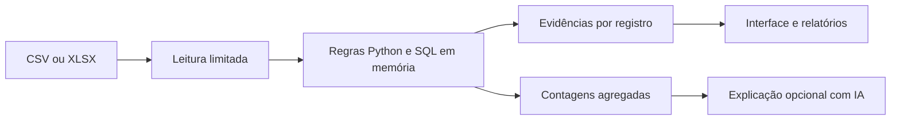

# DataCheck

[](https://github.com/GustavoCurio/datacheck/actions/workflows/tests.yml)

**Qualidade de dados com evidências, regras configuráveis e relatórios prontos para compartilhar.**

O DataCheck recebe arquivos CSV ou Excel, identifica inconsistências e mostra o registro, a coluna, o valor e a regra de cada ocorrência. A validação é feita em Python e SQL; uma integração opcional com IA explica as prioridades usando somente contagens agregadas.

## O que o sistema entrega

- Interface para enviar arquivos e configurar campos obrigatórios, identificadores, números e datas.
- Detecção de registros idênticos, chaves repetidas, campos vazios, números inválidos, valores negativos e datas inconsistentes.
- Diagnóstico visual, filtro de ocorrências e sugestões de verificação na origem.
- Relatório HTML, evidências em CSV e resultado/configuração em JSON.
- API FastAPI e execução em lote pela linha de comando.
- Demonstração com dados fictícios e benchmark reproduzível de até 50 mil registros.
- Explicação opcional pela OpenAI Responses API, com consentimento e saída estruturada.

## Executar

Python 3.12. No PowerShell, dentro da pasta do projeto:

```powershell
python -m venv .venv
.\.venv\Scripts\Activate.ps1
python -m pip install -r requirements.txt
python -m streamlit run app.py
```

Abra o endereço local exibido pelo Streamlit. A demonstração já inicia com as regras de pedidos aplicadas. Para outro arquivo, escolha **Enviar meu arquivo**, configure as regras e clique em **Validar dados**.

Em Linux/macOS, ative o ambiente com `source .venv/bin/activate`; os demais comandos são iguais.

## Demonstração verificável

A [base de exemplo](data/pedidos_demo.csv) contém dez pedidos fictícios. O resultado esperado é **9 ocorrências em 7 registros**, com três registros sem ocorrências nas regras escolhidas.

| Regra | Ocorrências |
|---|---:|
| Registro completamente idêntico | 2 |
| Identificador repetido | 2 |
| Campo obrigatório vazio | 1 |
| Número inválido | 1 |
| Valor negativo | 1 |
| Data inválida | 1 |
| Entrega anterior à compra | 1 |

As regras de duplicidade sinalizam todos os participantes do grupo, incluindo o primeiro. Um registro pode apresentar várias ocorrências; por isso, os totais de ocorrências e registros afetados são diferentes. O percentual sem ocorrências se refere apenas às regras selecionadas.

Resultado completo: [relatório JSON da demonstração](reports/demo/relatorio.json).

## Formatos e regras

- **CSV:** UTF-8 ou Windows-1252; vírgula, ponto e vírgula ou tabulação. A detecção automática pode ser substituída pela seleção explícita do separador.
- **XLSX:** seleção de uma aba por execução. Células com fórmulas são recusadas; exporte seus valores antes de enviar. Não são executadas macros ou fórmulas.
- Números em texto seguem o formato escolhido: `1,234.56` ou `1.234,56`. Símbolos monetários e notação científica não fazem parte destes formatos.
- Datas em texto aceitam `AAAA-MM-DD` ou `DD/MM/AAAA`, conforme a configuração; ISO também é aceito para datas nativas do Excel. Números nativos do Excel independem do separador textual.
- Valores vazios são texto vazio ou espaços. Textos como `NA` e `NULL` são preservados. Números e datas vazios só geram ocorrência quando também são obrigatórios.
- Duplicidade usa os valores exatos, sem normalizar espaços ou maiúsculas. Não há correção automática dos registros.
- Limites por arquivo: **10 MB, 50 mil registros, 50 colunas e 500 mil células**, com até 2 mil caracteres por célula. XLSX também tem limite descompactado de 30 MB e mil entradas internas.

O cabeçalho é a posição 1 e o primeiro registro de dados é 2. Em CSV com campos multilinha, essa posição lógica pode diferir da linha física. Linhas CSV completamente vazias são ignoradas.

## Relatórios em lote

```powershell
python -m datacheck data/pedidos_demo.csv --orders --output relatorio
python -m datacheck minha_base.csv --rules regras.json --delimiter ";" --output relatorio
```

O primeiro comando aplica a configuração de pedidos. Sem `--orders` ou `--rules`, somente registros completamente idênticos são verificados. A configuração JSON pode ser baixada na interface. Os comandos criam `relatorio.html`, `relatorio.json` e `ocorrencias.csv`.

## API

```powershell
python -m uvicorn datacheck.api:app --host 127.0.0.1 --port 8000
```

Documentação interativa: `http://127.0.0.1:8000/docs`.

| Rota | Função |
|---|---|
| `GET /health` | Confirma disponibilidade |
| `POST /audit` | Recebe arquivo e regras e devolve diagnóstico/evidências em JSON |

`POST /audit` usa multipart com `file`, `rules` (JSON textual), `delimiter`, `encoding` e `sheet` (índice da aba a partir de zero). A API executa validação local; a explicação com IA é acionada pela interface. A API não mantém histórico de arquivos.

## Explicação opcional com IA

O diagnóstico, as evidências e os relatórios funcionam sem chave de API. Para habilitar a explicação generativa, configure no ambiente do servidor:

```powershell
$env:OPENAI_API_KEY = "sua-chave"
$env:OPENAI_MODEL = "modelo-compativel-com-saida-estruturada"
python -m streamlit run app.py
```

O arquivo `.env.example` documenta as variáveis; não é carregado automaticamente. As chaves ficam no servidor. A chamada só acontece após autorização e clique em **Gerar explicação com IA**. São enviados os totais de registros, registros afetados, ocorrências e contagens por identificador de regra; células, nomes de colunas e arquivo não são enviados.

A integração usa `store=False`, schema estrito e validação de identificadores de regras. O texto generativo pode conter imprecisões; contagens e evidências determinísticas continuam sendo a referência. Falhas do provedor preservam o diagnóstico local.

## Validação e desempenho

```powershell
python -m pip install -r requirements-dev.txt
python -m pytest -q
python benchmark.py
```

**45 testes** cobrem regras, posições dos registros, formatos numéricos, datas, CSV, XLSX, fórmulas, limites de leitura, escape de relatórios, API, interface, execução em lote e contrato da integração de IA com cliente simulado.

Benchmark local em Python 3.12.14/Windows, mediana de três execuções:

| Registros sintéticos | Leitura do CSV | Motor de validação | Ocorrências esperadas/encontradas |
|---|---:|---:|---:|
| 1.000 | 2,63 ms | 16,99 ms | 50 / 50 |
| 10.000 | 18,76 ms | 158,77 ms | 500 / 500 |
| 50.000 | 108,98 ms | 1.058,87 ms | 2.500 / 2.500 |

[Medições e método](reports/benchmark.json). O benchmark mede leitura e validação, sem interface, exportação ou IA. O resultado varia com a máquina e a base. Não foi medida economia de trabalho humano. Os testes do provedor usam simulação; não foi feita chamada real à API.

## Arquitetura e estudo de caso



Consulte o [estudo de caso e decisões técnicas](docs/ESTUDO_DE_CASO.md). Tecnologias: Python, pandas, SQLite, openpyxl, Streamlit, FastAPI, Pydantic, pytest e OpenAI SDK.

O projeto demonstra uma automação de qualidade de dados com base fictícia. O processamento de arquivos na interface fica em memória por sessão. A execução pela linha de comando grava os relatórios na pasta indicada. Interface e API iniciam em endereço local; exposição externa exige autenticação, limitação de requisições e política de retenção apropriada.
